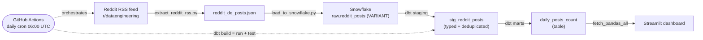

# Reddit Serverless ELT Pipeline

A serverless **ELT pipeline** that tracks daily posting activity in
[r/dataengineering](https://www.reddit.com/r/dataengineering/), models the raw data
with **dbt**, and surfaces it in a live **Streamlit** dashboard — fully automated on a
daily schedule with **GitHub Actions**.

> **Why this project?** I follow the data-engineering community, so tracking it is a
> self-referential way to demonstrate an end-to-end modern-data-stack workflow on a
> source I actually care about. It runs on **public data** and is built as a learning
> project, with a deliberate focus on *production habits* (testing, CI, idempotency)
> rather than data volume.

**Question it answers:** *How active is the r/dataengineering community day to day,
and how many distinct authors drive that activity?*

## Architecture



## Tech stack

| Layer | Tool |
|---|---|
| Extract | Python (`feedparser`) |
| Load | Python (`snowflake-connector-python`) |
| Warehouse | Snowflake (VARIANT / `PARSE_JSON`) |
| Transform | dbt (`dbt-snowflake`) — staging → marts, with tests |
| Serve | Streamlit |
| Orchestration | GitHub Actions (daily cron) |
| Packaging | Docker |

## How to run locally

1. **Provision Snowflake objects** (one-time): run `sql_scripts/01_snowflake_setup.sql`.
2. **Create a `.env`** in the repo root (it is git-ignored):
   ```env
   SNOWFLAKE_USER=...
   SNOWFLAKE_PASSWORD=...
   SNOWFLAKE_ACCOUNT=...
   SNOWFLAKE_WAREHOUSE=reddit_wh
   SNOWFLAKE_DATABASE=reddit_db
   SNOWFLAKE_SCHEMA=dbt_transform
   SNOWFLAKE_ROLE=...            # optional
   ```
3. **Install deps:** `pip install -r requirements.txt`
4. **Verify the connection:** `python connection.py`
5. **Run the pipeline:**
   ```bash
   python extract_reddit_rss.py
   python load_to_snowflake.py
   cd reddit_dbt && dbt build      # runs models AND tests
   ```
6. **Launch the dashboard:** `streamlit run dashboard.py`
   (or `docker build -t reddit-dash . && docker run -p 8501:8501 --env-file .env reddit-dash`)

## Data model

- **`raw.reddit_posts`** — landing zone, one VARIANT column holding the raw JSON.
- **`stg_reddit_posts`** — flattens the JSON into typed columns and **deduplicates by
  post URL** using `QUALIFY ROW_NUMBER()`, so re-runs never create duplicate rows.
- **`daily_posts_count`** — daily mart: total posts and distinct authors per day.

Data quality is enforced with dbt tests (`unique` + `not_null` on the post key) that
run in CI via `dbt build`.

## Design decisions & tradeoffs

- **ELT over ETL** — land raw JSON first, transform in-warehouse with SQL/dbt. Keeps the
  raw layer immutable and replayable.
- **Snowflake VARIANT** — store the raw payload as-is and parse on read, so schema
  changes at the source don't break ingestion.
- **RSS over the official Reddit API** — fastest path to a working end-to-end slice.
  *Tradeoff:* only ~25 newest posts and 4 fields per run (see Roadmap).
- **GitHub Actions over Airflow/Dagster** — zero infra for a simple linear daily job.
  *Tradeoff:* no dependency graph, backfills, or retries (see Roadmap).

## Roadmap / known limitations

- [ ] Switch to the official Reddit API (PRAW) for richer fields (score, comments,
      upvote ratio) and more volume.
- [ ] Incremental, append-only loads (MERGE on post id + watermark) to retain history.
- [ ] Proper star schema: `fct_posts` + `dim_author` / `dim_subreddit` / `dim_date`.
- [ ] dbt source freshness + expanded tests; publish dbt docs / lineage.
- [ ] Terraform to provision Snowflake objects (replacing the manual setup script).
- [ ] LLM topic/sentiment enrichment via Snowflake Cortex.
